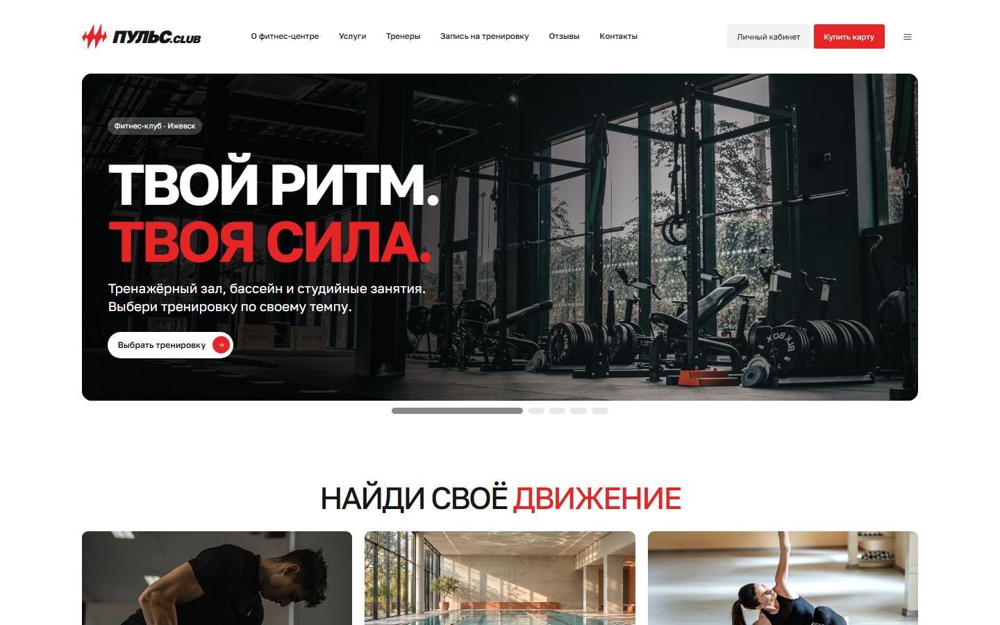

# Пульс.Club

Учебный сайт фитнес-центра в Ижевске на C# и Blazor. Посетители могут выбрать услугу и тренера, записаться на занятие и управлять записями в личном кабинете. Сотрудники работают с заявками и содержимым сайта в отдельной панели.

[**Открыть демо**](https://pulse-club.layero.app/) · [Упрощённая версия](src/FitnessCenter.Lite/README.md) · [Развёртывание](docs/DEPLOYMENT.md)



## Возможности

| Роль | Возможности |
| --- | --- |
| Посетитель | Каталог услуг и тренеров, расписание, контакты и опубликованные отзывы |
| Клиент | Запись на свободное время, отмена, история занятий, уведомления и отзывы после посещения |
| Менеджер | Обработка заявок, отметка посещений, просмотр отзывов и обращений |
| Администратор | Управление расписанием, каталогом, изображениями, пользователями, ролями, отзывами и содержимым сайта |

**Стек** · C# · .NET 10 · ASP.NET Core Blazor · Entity Framework Core · SQL Server · xUnit

## Запуск

Для полной версии нужны Windows, .NET SDK `10.0.403` или более новая версия SDK в ветке .NET 10 и SQL Server Express LocalDB. Для запуска из Visual Studio установите нагрузку «ASP.NET и веб-разработка».

**В Visual Studio** откройте `FitnessCenter.sln`, назначьте `FitnessCenter.Web` запускаемым проектом, выберите профиль `http-palette` и нажмите F5.

**В PowerShell** из корня репозитория:

```powershell
dotnet restore FitnessCenter.sln
dotnet run --project src/FitnessCenter.Web --launch-profile http-palette
```

Откройте [localhost:5197](http://localhost:5197/). При первом запуске в режиме Development приложение применяет миграции и заполняет учебную базу `PulseFitness`. Для другой базы задайте строку подключения через `ConnectionStrings__DefaultConnection`.

Локальные учётные записи `admin@pulse.local`, `manager@pulse.local` и `client@pulse.local` получают случайные пароли при создании. Пароли сохраняются в `src/FitnessCenter.Web/App_Data/demo-accounts.txt`. Панель сотрудников открывается по адресу `/staff`, каталог администратора — по `/admin/catalog`.

### Упрощённая версия

Главная, «О клубе» и «Услуги» работают с каталогом на C#. Для запуска достаточно .NET SDK.

```powershell
dotnet run --project src/FitnessCenter.Lite --launch-profile http
```

Откройте [localhost:5196](http://localhost:5196/). Для F5 используйте [отдельное решение](src/FitnessCenter.Lite/FitnessCenter.Lite.sln).

## Структура

| Путь | Что внутри |
| --- | --- |
| [`src/FitnessCenter.Web`](src/FitnessCenter.Web) | Страницы Blazor, бизнес-логика, модели, миграции и веб-ресурсы |
| [`src/FitnessCenter.Lite`](src/FitnessCenter.Lite) | Автономная версия на три страницы |
| [`tests/FitnessCenter.Tests`](tests/FitnessCenter.Tests) | Проверки записи, прав доступа, содержимого и изображений |
| [`deploy/layero`](deploy/layero) | HTTPS-прокси для публичного домена |
| [`docs`](docs) | Документация, материалы и исторический план разработки |
| [`tools/portable`](tools/portable) | Скрипт запуска опубликованной Lite-сборки на Windows |

## Проверки

```powershell
dotnet test FitnessCenter.sln
```

Интеграционные тесты создают отдельные временные базы SQL Server LocalDB и удаляют их после выполнения.

## Материалы

Название, профили, контакты и отзывы демонстрационные. Сведения об изображениях и промптах собраны в [документации](docs/ASSETS.md). Интерфейс использует Golos Text по [лицензии SIL OFL](src/FitnessCenter.Web/wwwroot/fonts/golos-text-OFL.txt), если ABC Repro Cyrillic отсутствует в системе.
